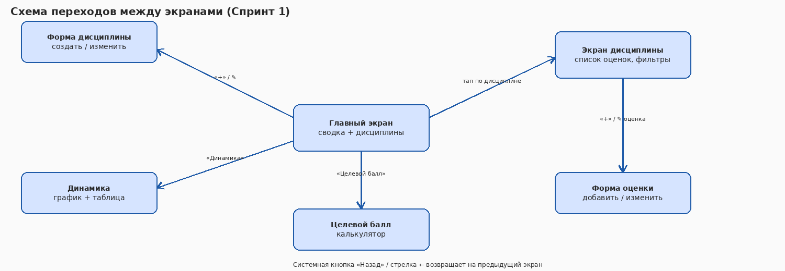
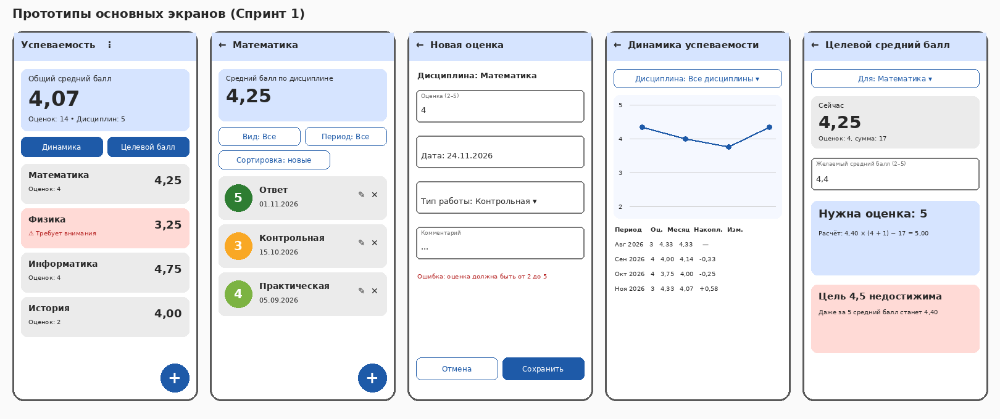

# Спринт 1. Анализ требований, сценарии и прототип интерфейса

## 1. Паспорт приложения
**Название:** «Успеваемость». **Назначение:** студент вносит учебные оценки, видит средний балл по каждой дисциплине и в целом, следит за динамикой и планирует, какая оценка нужна для желаемого среднего.
**Платформа:** Android 8.0+ (API 26), Kotlin, Room. **Хранение:** локально на устройстве, без регистрации и сети.

## 2. Что студент видит на главном экране
Общий средний балл (крупно) · число оценок и дисциплин · пояснение «среднее арифметическое по всем записям» · кнопки «Динамика» и «Целевой балл» · список дисциплин со средним баллом; дисциплины со средним ниже 3,50 подсвечены красным с пояснением текстом.

## 3. Перечень экранов
1. Главная сводка + список дисциплин.
2. Экран дисциплины (список оценок, фильтры, сортировка).
3. Форма дисциплины (создание/изменение).
4. Форма оценки (добавление/редактирование).
5. Динамика (график + таблица по месяцам).
6. Целевой балл (калькулятор).

Схема переходов: `images/screen-flow.png`. Прототипы: `images/wireframes.png`.

## 4. Правила оценивания (согласованы командой)
| Правило | Решение |
|---|---|
| Допустимые оценки | целые числа 2–5 |
| Способ расчёта | среднее арифметическое = сумма / количество; все оценки равного веса |
| Нет оценок | средний балл не считается, показывается «—» и пояснение; деления на ноль нет |
| Формат отображения | 2 знака после запятой, десятичная запятая (4,25) — единый `formatAverage` |
| Дата оценки | не может быть в будущем |
| Типы работ | Контрольная, Практическая, Лабораторная, Ответ, Экзамен, Другое |
| Низкий средний | < 3,50 → подсветка + текст причины |
| Удаление дисциплины | вместе с оценками, после диалога с указанием числа удаляемых оценок |
| Дубликаты дисциплин | запрещены (без учёта регистра) |

## 5. Пользовательские сценарии и критерии приёмки

| № | Сценарий | Критерии приёмки |
|---|---|---|
| С1 | Студент открывает приложение и видит общую сводку | Показаны общий средний, число оценок/дисциплин; при пустой базе — понятное сообщение и кнопка загрузки тестовых данных; общий средний совпадает с ручным расчётом |
| С2 | Выбирает дисциплину и просматривает оценки | Тап по дисциплине открывает список: оценка, дата, тип, комментарий; сверху средний по дисциплине; при отсутствии оценок — заглушка |
| С3 | Добавляет новую оценку | Форма требует оценку 2–5; дата по умолчанию сегодня, будущая запрещена; тип выбирается из списка; после сохранения запись видна в списке, средние пересчитаны |
| С4 | Исправляет ошибочную оценку или удаляет запись | Редактирование открывает форму с текущими значениями; удаление — только после подтверждения; средние пересчитываются сразу |
| С5 | Фильтрует оценки за период и по типу работы | Фильтры «Вид» и «Период» работают совместно; показывается средний по фильтру и «N из M»; «Сбросить» возвращает всё; пустой результат — понятное сообщение |
| С6 | Проверяет средний балл и смотрит динамику | Таблица по месяцам: число оценок, средний за месяц, накопленный средний, изменение; график; при отсутствии данных — заглушка |
| С7 | Задаёт желаемый средний и узнаёт нужную оценку | Выдаётся минимальная целая оценка; при недостижимости — сообщение с максимально возможным средним; при цели вне 2–5 — сообщение об ошибке |

## 6. Распределение ролей и задач спринта
| Роль | Задачи |
|---|---|
| Product Owner / аналитик | паспорт, сценарии и критерии приёмки, правила оценивания, структура демонстрации |
| Lead Developer | создание проекта Android Studio, структура пакетов `data/domain/ui`, согласование модели данных |
| QA / DevOps | чек-лист приёмки по сценариям С1–С7, шаблон тест-кейсов (`test-cases.md`), настройка репозитория и сборки |

Роли ротируются каждые 2 спринта (см. `roles-report.md`).

**Результат:** паспорт ✔, схема экранов ✔, 7 сценариев (≥5) ✔, прототипы ✔, список задач ✔.
**Контрольная точка:** показать `wireframes.png` и `screen-flow.png`, согласовать правила оценивания.
